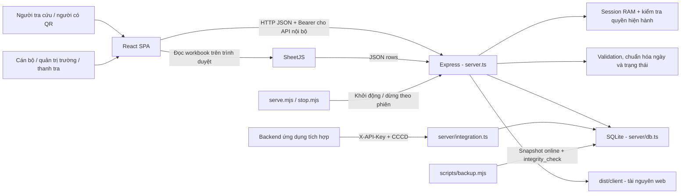
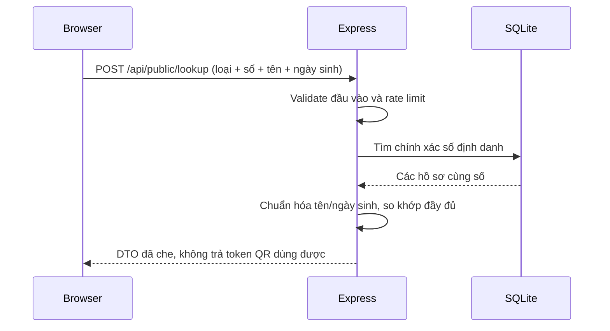

# Kiến trúc hệ thống

Cập nhật: 21/10/2026. Mô tả triển khai hiện tại, sau đợt sửa bảo mật và thiết kế lại giao diện. Điểm bắt đầu: [README](../README.md).

## Mục tiêu và phạm vi

Hệ thống quản lý hồ sơ tập huấn nghiệp vụ lái xe kinh doanh vận tải, thông tin cơ sở đào tạo và giấy chứng nhận (GCN). Cổng công khai hỗ trợ đối chiếu thông tin học viên và xác thực bằng token QR; khu cán bộ phục vụ quản lý, nhập/xuất Excel và xem nhật ký.

Đơn vị chủ quản: Sở Xây dựng TP. Hồ Chí Minh. Đơn vị hỗ trợ: Trung tâm Quản lý Giao thông công cộng TP.HCM.

Hệ thống hiện là một ứng dụng triển khai chung frontend/backend, không phải kiến trúc microservice. Không có SSO, MFA, dịch vụ gửi email, hàng đợi, dịch vụ ký số hoặc object storage được tích hợp. Đối chiếu CCCD/GPLX + họ tên + ngày sinh là kiểm tra hồ sơ, không phải MFA.

## Sơ đồ thành phần

Trong production, Express phục vụ `dist/client`. Bundle backend `dist/server.cjs` và sourcemap nằm ngoài thư mục static. Trong development, Express gắn Vite middleware để phát triển frontend với HMR.

## Phân chia mã nguồn

`server/catalogs.ts` quản lý schema và API danh mục chương trình/đơn vị KDVT; `CatalogManagement` dùng chung giao diện hai trang. `CatalogNameInput` nạp danh sách hoạt động qua phân trang để chọn. Hồ sơ lưu trainingProgramId/transportUnitId và snapshot tên; backend xác thực ID khi chọn mới, giữ tên lịch sử khi giữ nguyên liên kết. Quan hệ logic chưa có SQL FOREIGN KEY. Chi tiết: [CATALOGS.md](CATALOGS.md).

| Thành phần | Trách nhiệm |
| --- | --- |
| `server.ts` | Middleware, xác thực, giới hạn request, kiểm tra quyền endpoint, JSON/Excel response, static/SPA fallback |
| `server/db.ts` | Schema, truy vấn, tạo/sửa hồ sơ và user, mật khẩu, seed có điều kiện, DTO công khai, audit log |
| `server/rules.ts` | `InputError`, parse ngày, ngày hiện tại Việt Nam, trạng thái hiệu lực, tuổi và độ dài mật khẩu |
| `server/integration.ts` | Schema khóa/usage, cấp và thu hồi khóa, SHA-256, phạm vi cơ sở và quota bền vững, API tích hợp chỉ đọc |
| `src/App.tsx` | Khôi phục phiên, route guard, bố cục chung, điều phối màn hình và đăng xuất |
| `src/utils/router.ts` | History API, nhận alias đường dẫn, điều hướng và token QR cũ |
| `src/utils/api.ts` | Wrapper fetch; phát sự kiện `auth-invalidated` khi API nội bộ trả 401 |
| `src/utils/excel.ts` | Ánh xạ header dùng chung cho browser và API import |
| `src/components` | Trang nghiệp vụ, shell, form và modal; chi tiết trong [thiết kế giao diện](UI_DESIGN.md) |
| `scripts` | Build helper, launcher, backup và kiểm thử database riêng |

`CertificateManagement` được lazy-load; SheetJS trong module này không nằm trong bundle chính. TypeScript được kiểm tra trước khi build Vite/esbuild.

`Dashboard` là màn hình xác thực tại `/dashboard`, mở sau login. Dữ liệu lấy từ endpoint `/api/admin/stats` dùng chung với các chỉ số trang quản lý GCN; database tổng hợp chuỗi 6 tháng theo createdAt UTC+7 và số GCN sắp hết hạn trong 30 ngày. Không có dịch vụ analytics hoặc dữ liệu mô phỏng. Khi sửa endpoint phải giữ tương thích các trường cũ và bảo vệ toàn bộ phần tổng hợp theo phạm vi trường.

## Các đường truy cập dữ liệu

| Kênh | Điều kiện | Dữ liệu trả về |
| --- | --- | --- |
| Tra cứu công khai | Đúng loại giấy tờ, số 12 chữ số, tên đầy đủ và ngày sinh | CCCD/GPLX đã che, không có token dùng được hoặc địa chỉ chi tiết |
| Xác thực QR | Có token hợp lệ của hồ sơ | CCCD/GPLX đầy đủ, thông tin chứng nhận và trạng thái hiệu lực |
| API quản trị | Session còn hiệu lực và đúng quyền | Hồ sơ nội bộ; trường chỉ truy cập phạm vi `schoolCode` được gán |
| API tích hợp | API key chưa hết hạn/thu hồi, người cấp vẫn là SUPERADMIN hoạt động, cơ sở trong phạm vi còn hoạt động | Chứng nhận theo một CCCD hoặc GPLX, DTO đầy đủ giống xác thực QR (gồm token QR), cộng isValid; tối đa 100 hồ sơ/request |

QR token là khả năng truy cập hồ sơ, không phải chữ ký số của văn bằng. Backend tra cứu database và phản ánh trạng thái; không thực hiện kiểm chứng chữ ký PKI. Chặn phím hoặc phát hiện DevTools chỉ là hành vi giao diện, không thay thế phân quyền API.

## Phiên và phân quyền

Token phiên được sinh bằng 32 byte ngẫu nhiên từ `crypto`, thời hạn tuyệt đối 24 giờ từ lúc đăng nhập; không phải JWT và không có refresh token. Server giữ session trong Map RAM, nạp user hiện hành từ database cho request được bảo vệ. Cập nhật/xóa user qua API sẽ thu hồi mọi phiên của user đó.

Browser lưu token và metadata đăng nhập trong localStorage, xác minh lại qua `/api/auth/me` khi khởi động. Dữ liệu user trong localStorage không quyết định quyền backend. Đăng xuất gọi server; nếu lỗi mạng, giao diện thông báo chưa hủy được phiên.

Session và bộ đếm rate limit theo IP là dữ liệu trong từng process. Restart hủy toàn bộ phiên; API key và bộ đếm quota theo khóa lưu SQLite vẫn được giữ. Triển khai nhiều process/replica cần bổ sung session store, kho rate limit theo IP dùng chung và kiểm chứng lại quy trình cấp số/SQLite; kiến trúc hiện tại phù hợp một process ứng dụng cho một database.

## Ranh giới bảo mật và lưu trữ

- Mặc định server chỉ nghe `127.0.0.1`, không tin header proxy. Nếu triển khai LAN/Internet, cấu hình hạ tầng theo [vận hành](OPERATIONS.md).
- Password lưu scrypt với salt riêng. Hồ sơ, token QR và metadata trong SQLite không có cơ chế mã hóa ổ đĩa do ứng dụng cung cấp.
- `DATA_DIR` chứa database; `storage/uploads` được tạo nhưng hiện không có API tải tệp hồ sơ lên.
- Audit log giữ tối đa 10.000 sự kiện gần nhất. Log từ browser luôn mang action `CLIENT_EVENT` và không được coi là sự kiện nghiệp vụ xác thực.
- Database và backup không thuộc source Git. Không dùng file export Excel thay cho snapshot SQLite.

## Quyết định thiết kế và giới hạn

| Quyết định hiện tại | Hệ quả |
| --- | --- |
| SQLite native `node:sqlite`, WAL | Đóng gói portable thuận tiện, tránh native addon ngoài; truy vấn đồng bộ có thể chặn event loop khi tải lớn |
| Quan hệ trường/user/hồ sơ kiểm tra trong code | Phải đi qua service/validation; SQL trực tiếp có thể phá ràng buộc logic |
| Trạng thái hiệu lực được suy ra khi đọc | Hết hạn tự phản ánh theo ngày, không cần job sửa mọi bản ghi |
| Không tự migrate lại điểm lịch sử | Bảo toàn dữ liệu cũ; cần đối chiếu các hồ sơ từng bị ghi sai |
| Import tạo mới, có savepoint | Hỗ trợ batch có rollback; chưa có quy trình đồng bộ/upsert từ Excel |

Các hạng mục chưa triển khai: migration schema có version, lưu session bền vững, audit archive dài hạn, lịch backup tự động, thu hồi/đổi QR hàng loạt và giám sát vận hành tập trung. Đây là hướng mở rộng, không phải tính năng đang có.

Tài liệu liên quan: [dữ liệu và nghiệp vụ](DATA_MODEL.md), [API](API.md), [kiểm thử](TESTING.md).
