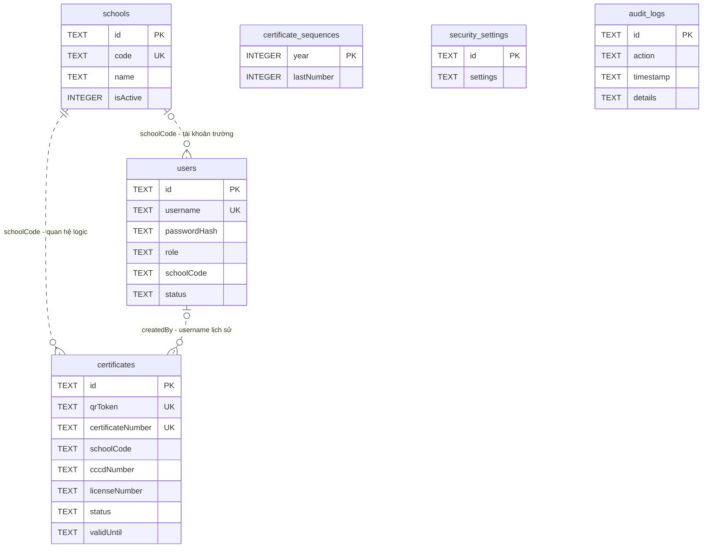
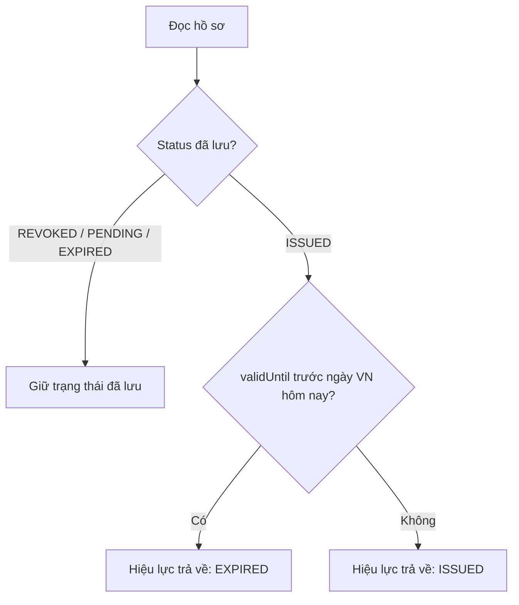

# Mô hình dữ liệu và quy tắc nghiệp vụ

Cập nhật: 21/10/2026. Nguồn đối chiếu: `server/db.ts`, `server/rules.ts`, `src/types.ts` và luồng import trong `server.ts`.

## Lưu trữ và quan hệ

Dữ liệu lịch sử có thể còn DD/MM/YYYY, dù hồ sơ ghi mới dùng ISO. `normalizeCertificateDates` dùng chung tại DTO quản trị và form chỉnh sửa để tránh ô input date hiển thị rỗng. Không tự migrate toàn bộ ngày lịch sử; đọc không thay dữ liệu lưu trữ. Khi chủ động lưu hồ sơ, ngày được chuẩn hóa ISO nhưng giữ cùng ngày lịch, ID/liên kết và hạn cũ nếu không chủ động thay đổi.

Danh mục chương trình tập huấn và đơn vị KDVT có hai bảng `training_programs`, `transport_units`, được tạo bổ sung trong `server/catalogs.ts`. Certificates có `trainingProgramId`, `transportUnitId` TEXT mặc định rỗng, liên kết logic tới hai bảng; backend kiểm tra mục hoạt động khi chọn mới. `courseName` và `transportUnit` là tên chụp tại thời điểm chọn, giữ nguyên khi danh mục đổi. Schema và ràng buộc: [CATALOGS.md](CATALOGS.md).

Database tại `<DATA_DIR>/app.db`, mặc định `./db/app.db`. SQLite mở WAL và bật `PRAGMA foreign_keys=ON`; schema hiện **không khai báo FOREIGN KEY**, CHECK enum hay bảng migration version. Quan hệ dưới đây là quan hệ logic do code ứng dụng kiểm tra.

Xóa user không xóa các hồ sơ đã tạo. Không có bảng học viên/khóa học riêng: thông tin nhân thân, cơ sở và khóa học hiện được lưu cùng từng hồ sơ chứng nhận. Một CCCD có thể có nhiều chứng nhận; CCCD/GPLX không có unique constraint toàn bảng.

## Khóa tích hợp và usage

`server/integration.ts` tạo thêm hai bảng bằng CREATE TABLE/INDEX IF NOT EXISTS khi server khởi động, không xóa hồ sơ cũ:

| Bảng | Trường và quan hệ logic |
| --- | --- |
| `api_keys` | `id` PK, `name`, `organization`, `keyHash` unique SHA-256, `keyPrefix`; không lưu khóa gốc |
| `api_keys` | `schoolCode` nullable (null: toàn hệ thống), `status` ACTIVE/REVOKED, `expiresAt`, `createdAt`, `createdBy` là **user ID**, `revokedAt` |
| `api_keys` | `lastUsedAt`, `lastUsedIp`, `requestCount`, `rateLimit`; `windowStart` epoch ms đầu phút UTC, `windowCount` lưu quota bền vững |
| `api_key_usage` | `id` PK là request UUID, `apiKeyId` liên kết khóa, `timestamp`, `ip`, `httpStatus`, `resultCount`; index `(apiKeyId,timestamp)` |

EXPIRED là trạng thái suy ra từ expiresAt khi đọc metadata. Xác thực còn yêu cầu người cấp hiện là SUPERADMIN hoạt động và cơ sở trong phạm vi hoạt động. Thu hồi không xóa dòng khóa hoặc lịch sử. Không có FOREIGN KEY cho các bảng mới; xóa người cấp làm khóa không còn xác thực được. Usage giữ 10.000 dòng gần nhất toàn hệ thống, không chứa CCCD/body/response/secret. Chi tiết hợp đồng và bộ đếm: [INTEGRATION.md](INTEGRATION.md).

## Từ điển dữ liệu

| Bảng | Nhóm trường / cách sử dụng |
| --- | --- |
| `certificates` | Định danh: `id`, `qrToken`, `certificateNumber`; cả ba duy nhất, hai trường sau NOT NULL |
| `certificates` | Nhân thân: `fullName`, `dateOfBirth`, `cccdNumber`, `cccdIssueDate`, `phoneNumber`, `address`, `avatarUrl` |
| `certificates` | GPLX: `licenseNumber`, `licenseClass`, `licenseIssueDate` |
| `certificates` | Đào tạo: `schoolName`, `schoolCode`, `courseCode`, `courseName`, `coorganizingUnit`, `transportUnit` |
| `certificates` | Kết quả: `examEligibility`, `examScore`, `examResult`, `trainingStartDate`, `trainingEndDate`, `examDate` |
| `certificates` | Chứng nhận: `status`, `decisionNumber`, `decisionDate`, `issueDate`, `validUntil`, `signatoryName`, `signatoryTitle`, `revokedReason`, `notes` |
| `certificates` | Lịch sử cơ bản: `createdAt`, `updatedAt`, `createdBy`; không lưu phiên bản đầy đủ của từng lần sửa |
| `schools` | `id`, `name`, `code` unique; địa chỉ/liên hệ/giấy phép; `classes` JSON array; `isActive`, `status`, timestamps |
| `schools` | Cột `certifiedCount`, `sampleToken` còn trong schema để tương thích. API danh bạ tính lại số hồ sơ và trả `sampleToken` rỗng |
| `users` | `id`, `username` unique, `passwordHash`, `fullName`, `role`, `schoolName`, `schoolCode`, `status`, `createdAt`, `lastLogin` |
| `certificate_sequences` | Bộ đếm theo năm, không phải số lượng hồ sơ còn tồn tại |
| `security_settings` | Bản ghi `id=global`, `settings` là JSON; các cờ chặn phím/chuột/DevTools và watermark |
| `audit_logs` | `id`, `action`, `target`, `ip`, `userAgent`, `timestamp`, `details` JSON hoặc null |

`address` lưu TEXT chứa JSON object; API chấp nhận object có các trường văn bản hoặc chuỗi, sau đó chuẩn hóa chuỗi thành địa chỉ dạng object. DTO công khai không trả `address` gốc.

Các index bổ sung của `certificates`: token, số GCN, CCCD, GPLX, mã trường và trạng thái. Định nghĩa đầy đủ cột/NOT NULL/DEFAULT nằm trong schema của `server/db.ts`; không suy diễn constraint từ interface TypeScript.

## Quy tắc hồ sơ mới và cập nhật

- Bắt buộc họ tên, CCCD, GPLX, hạng GPLX, mã trường, mã khóa, tên khóa và ngày sinh hợp lệ. Họ tên lưu mới được viết hoa và trim.
- CCCD/GPLX là chuỗi 12 chữ số, giữ số 0 đầu; điện thoại nếu có phải có 10 chữ số bắt đầu bằng 0.
- Ngày sinh từ 1900 và đủ 18 tuổi theo ngày hiện tại Việt Nam. Đây là quy tắc kỹ thuật hiện có, không phải kiểm tra mọi điều kiện pháp lý của từng hạng GPLX.
- Tạo mới phải gắn với trường tồn tại và đang hoạt động; tên trường lấy từ database. Hồ sơ cũ thuộc trường ngừng hoạt động vẫn có thể được sửa trong phạm vi trường cũ.
- Mã trường đã tạo không được đổi. `SCHOOL_ADMIN` không được chuyển trường của hồ sơ qua API.
- Tài khoản trường phải gắn trường hoạt động khi tạo/sửa tài khoản. Ngừng trường không tự đổi trạng thái tất cả tài khoản/hồ sơ liên quan.

Ngày mới được chuẩn hóa ISO `YYYY-MM-DD`; nhận thêm dạng ngày-tháng-năm bằng `/`, `-`, `.`. Ngày không tồn tại bị từ chối. Ngày kết thúc không trước ngày bắt đầu; ngày hết hạn không trước ngày cấp. Từ 23/10/2026, ngày cấp mặc định theo ngày Việt Nam UTC+7, hạn mặc định cộng **5 năm lịch** qua hàm dùng chung frontend/backend; 29/02 chuyển thành 28/02 nếu năm đích không nhuận. Hạn ngoại lệ được gửi hợp lệ qua form/API/Excel được ưu tiên.

Không cập nhật hàng loạt hồ sơ cũ. PUT không đổi ngày cấp giữ hạn hiện tại; đổi ngày cấp nhưng không gửi validUntil sẽ tính lại 5 năm. Nếu validUntil được gửi thì phải là ngày hợp lệ, không rỗng và không trước ngày cấp. Form tự tính lại khi người dùng thay ngày cấp, sau đó vẫn cho sửa hạn ngoại lệ. Hết hiệu lực khi đọc tiếp tục tính theo ngày Việt Nam UTC+7.

## Điểm và trạng thái

| Đầu vào điểm | Giá trị chuẩn hóa / kết quả |
| --- | --- |
| `0`, `0/10` | `0/10`, Không đạt |
| `8`, `8/10`, `80/100` | `8/10`, Đạt |
| Số đơn >10 đến 100 | Chia 10 trước khi chấm; ví dụ `20` thành `2/10` |
| Phân số có mẫu dương | Quy đổi về thang 10 |
| Trống/null/undefined | Chuỗi điểm rỗng, Không đạt; không suy diễn thành 10 |
| Không phải số, âm, vượt thang sau quy đổi | Từ chối |

Điểm được làm tròn 1 chữ số thập phân trước khi so ngưỡng 5/10. `examResult` được tính từ điểm khi validation, không dựa vào nhãn người dùng tự gửi.

Nếu tạo thủ công không chỉ định `status`, code chọn `ISSUED` khi đạt và điều kiện kiểm tra không chứa “chưa”/“không”; các trường hợp còn lại chọn `PENDING`. Đặt `ISSUED` hoặc `EXPIRED` khi chưa đạt/chưa đủ điều kiện bị từ chối. Import chủ động chọn `ISSUED`/`PENDING` theo điểm; dòng đạt điểm nhưng chưa đủ điều kiện có thể bị báo lỗi khi validation, không tự chuyển PENDING.

Ngày cuối trên GCN vẫn có hiệu lực hết ngày đó. Ví dụ `validUntil=2026-10-21` được suy ra EXPIRED từ 22/10/2026 theo giờ Việt Nam. Việc suy ra không sửa status trong database; status EXPIRED đã lưu vẫn giữ EXPIRED dù đổi ngày hết hạn, trừ khi chủ động sửa trạng thái.

Chưa có ma trận chuyển trạng thái bắt buộc theo từng bước; API kiểm tra enum và điều kiện cấp. Không nên mô tả hệ thống là workflow phê duyệt nhiều cấp hoặc thu hồi không thể đảo ngược.

## Cấp số và token

GCN tự sinh theo `GCN-<năm>-<sequence tối thiểu 5 chữ số>`. Bộ đếm lấy mốc từ số lớn nhất còn có trong năm và tăng bằng một câu lệnh SQLite nguyên tử. Xóa hồ sơ không giảm bộ đếm. Có thể có khoảng trống khi thao tác sau cấp số thất bại; không yêu cầu số liên tục tuyệt đối. API tạo thủ công còn cho gửi số GCN riêng và kiểm tra unique ở database.

Token QR là 20 byte ngẫu nhiên, biểu diễn bằng 40 ký tự hex. Token không tự hết hạn như session; trạng thái thu hồi/hết hạn của GCN vẫn được trả khi tra token. Xóa hồ sơ làm token không tìm thấy. Chưa có endpoint rotate token.

`decisionNumber`/người ký là dữ liệu văn bản, không có hệ thống xác minh quyết định hoặc chữ ký số. Backend còn fallback số quyết định hậu tố `QĐ-GTVT` và một số nhãn mẫu; khi cấp thật cần nhập đúng dữ liệu nghiệp vụ, không coi fallback là quyết định đã ban hành.

## Lưu ý dữ liệu cũ

Danh bạ hiện đếm hồ sơ khi `schoolCode` khớp **hoặc** `schoolName` khớp để tương thích dữ liệu cũ; không phải số người duy nhất hay riêng số GCN còn hiệu lực. Tên trường dạng bản sao trong hồ sơ/user không được đồng bộ hàng loạt khi đổi tên trường.

Bản vá không tự sửa điểm, chữ ký hay ngày sai trong lịch sử, không xóa các bản database trong lịch sử Git và không đổi token QR cũ. Các dữ liệu cần đối chiếu được ghi trong [kết quả sửa lỗi](../REMEDIATION-2026-10-21.md).
