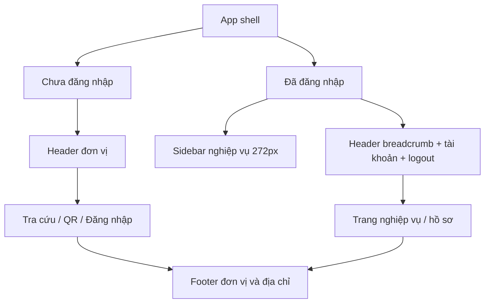

# Thiết kế giao diện và trải nghiệm sử dụng

Cập nhật: 21/10/2026. Mô tả giao diện đã triển khai, không phải mockup cho một phiên bản tương lai. Source chính: `src/index.css`, `src/App.tsx`, `src/components`.

## Định hướng

Giao diện dùng nền sáng, xanh rừng và khoảng trống để phân biệt nội dung chính/phụ. Cổng công khai tập trung vào tra cứu và đối chiếu; khu cán bộ tập trung vào danh sách, bộ lọc và thao tác nghiệp vụ. Giữ tiếng Việt có dấu, nhận diện đơn vị và nội dung hướng dẫn ngắn, dễ đọc.

Không dùng số liệu thống kê giả, thông tin học viên điền sẵn hoặc tài khoản quản trị demo trong giao diện. Hình chứng nhận minh họa ở trang tra cứu là thành phần trang trí dựng bằng HTML/CSS và icon, không phải GCN của một cá nhân.

## Hệ thống thị giác

| Thành phần | Giá trị triển khai |
| --- | --- |
| Nền ứng dụng | `--surface: #f5f7f5` |
| Chữ chính | `--ink: #193c32` |
| Viền | `--line: #e0e8e3` |
| Xanh thương hiệu | `--green: #146e56` |
| Sidebar | `#123e32` |
| Nút chính tra cứu/đăng nhập | `#235d43`, hover `#194a35` |
| Nút chính khu nghiệp vụ | Override nền `#255f44` trong `.workspace-panels` |
| Font | Segoe UI, system-ui, font hệ điều hành; không tải webfont ngoài |
| Icon | Lucide React; icon hành động đi cùng nhãn hoặc aria-label |
| Bo góc | Form/card công khai 18–22px; panel nghiệp vụ khoảng 15px; input/nút khoảng 8–13px |
| Trường nhập công khai | Cao 49px sau override cuối stylesheet, chữ 14px |
| Nút tìm kiếm | Cao tối thiểu 48px, trạng thái loading/disabled |

CSS gồm token Tailwind `@theme`, các class component và một số override cuối file để cải thiện độ đọc. Khi sửa màu/kích thước cần kiểm tra cascade ở cuối file; không chỉ sửa khai báo đầu tiên của selector.

## Bố cục chung

Guest không có sidebar; lối vào cán bộ nằm ở footer. Sau đăng nhập, sidebar chia nhóm Nghiệp vụ và Hệ thống. Bộ lọc trạng thái con chỉ hiện khi đang ở trang tương ứng. Header hiển thị tên màn hình, người dùng và nút đăng xuất; tên vai trò hiển thị phù hợp quản trị, trường hoặc thanh tra.

## Màn hình và luồng chính

Hai trang `/training-programs` và `/transport-units` dùng `CatalogManagement`: tìm mã/tên, lọc hoạt động/ngừng, bảng cuộn riêng, phân trang, tạo/sửa inline. SUPERADMIN có nút ghi, vai trò còn lại chỉ xem. Form chứng nhận dùng `CatalogNameInput` dạng select [MÃ] Tên đầy đủ, lưu ID liên kết; không nhập tay. Chương trình mới bắt buộc chọn, đơn vị tùy chọn. Hồ sơ cũ có lựa chọn giữ tên chưa liên kết; mục đã ngừng vẫn hiện nếu đang gắn với hồ sơ. Chi tiết: [CATALOGS.md](CATALOGS.md).

| Màn hình / component | Bố cục và hành vi |
| --- | --- |
| `/dashboard` — Dashboard | Trang mặc định sau login; chỉ số, biểu đồ hồ sơ tạo mới 6 tháng, phân bố trạng thái, 5 hồ sơ gần đây, GCN sắp hết hạn và truy cập nhanh |
| `/lookup` — PublicLookup | Desktop có intro/minh họa và card form; chọn CCCD/GPLX, nhập 3 thông tin, nút tra cứu; phía dưới hướng dẫn ba bước |
| Kết quả lookup | Banner trạng thái và 4 nhóm thông tin dùng chung với verify-certificate; định danh vẫn che, hạng GPLX và dòng rỗng được ẩn; không có nút lấy QR token |
| `/login` — StaffLogin | Hai phần: thông điệp nhận diện và form. Có xem/ẩn mật khẩu, loading, lỗi xác thực và hướng dẫn liên hệ quản trị |
| `/certificates` — CertificateManagement | Tiêu đề/thao tác, số liệu, bộ lọc và danh sách; modal tạo/sửa/trạng thái, nhập/xuất Excel; lazy-load |
| `/schools` — SchoolDirectory | Danh bạ, bộ lọc hoạt động; superadmin có thêm/sửa, mã trường cũ không cho sửa |
| `/admin` — AdminPortal | Quản trị tài khoản với superadmin; vai trò khác xem thông tin tài khoản của mình |
| `/admin/security` | Tab cấu hình an ninh/audit trong AdminPortal cho superadmin |
| `/verify-certificate/:token` — CertificateVerificationView | Banner nhận dạng và các nhóm thông tin xếp dọc; trạng thái thu hồi/hết hạn được ưu tiên hiển thị |

Các component modal khác như AuthModal, DigitalCertificateCardModal, SecurityAlertModal còn trong source. Không coi mọi component còn tồn tại là một mục điều hướng độc lập hoặc tính năng đã có nút mở trong mọi màn hình.

### Dashboard tổng quan

Dashboard đứng đầu menu Nghiệp vụ và chỉ hiện sau xác thực. Với SCHOOL_ADMIN, số liệu/trường/hồ sơ đều theo schoolCode trong user; SUPERADMIN và INSPECTOR xem toàn hệ thống. Trang quản trị tài khoản vẫn ở `/admin`.

Bốn ô chính: tổng hồ sơ, còn hiệu lực, chờ cấp và hết hiệu lực; chọn ô dẫn đến bộ lọc tương ứng ở `/certificates`. Biểu đồ cột có đủ 6 tháng kể cả tháng 0 hồ sơ, đếm createdAt theo UTC+7. Biểu đồ vòng có nhãn, số và tỷ lệ cho bốn trạng thái; màu không phải tín hiệu duy nhất. Không hiển thị phần trăm tăng trưởng giả khi chưa có phép so sánh.

Khối sắp hết hạn tính ngày hôm nay đến hết ngày thứ 30, chỉ GCN ISSUED theo hiệu lực hiện tại. Bảng gần đây không trả QR token hoặc định danh đầy đủ; nút Xem tất cả mở danh sách có quyền truy cập. Loading, lỗi/thử lại, dữ liệu trống và thời điểm cập nhật đều có trạng thái riêng. Làm mới là thao tác chủ động, không có polling tự động.

Grid chỉ số từ 4 xuống 2 cột; hai chart và bảng/khối phụ xếp dọc khi container hẹp. Khu bảng cuộn ngang trong panel. Nếu frontend mới gọi backend chưa restart, trang báo cần khởi động lại server thay vì dùng dữ liệu thiếu trường để vẽ biểu đồ giả.

### Tra cứu công khai

Chọn loại giấy tờ sẽ xóa số giấy tờ đang nhập và kết quả cũ, tránh dùng nhầm số giữa CCCD/GPLX. Trường số chỉ giữ chữ số và tối đa 12 ký tự; tên nhận văn bản; ngày sinh dùng native date input. Backend vẫn là nơi đối soát cuối cùng.

Các trạng thái cần hiển thị: ban đầu, đang tìm, có kết quả, không tìm thấy, sai đầu vào, lỗi kết nối và bị giới hạn request. Kết quả định danh bị che ở response, không chỉ làm mờ bằng CSS. Muốn xem hồ sơ đầy đủ phải dùng QR trên giấy chứng nhận.

### Tạo/sửa hồ sơ

Nhãn thời hạn là “Thời Hạn Đến Ngày (Chu kỳ 5 năm)”. Tạo mới mặc định ngày cấp hôm nay theo giờ Việt Nam, hạn sau 5 năm; thay ngày cấp sẽ tính lại hạn, cho phép sửa ngày hết hạn ngoại lệ sau đó. Chỉ mở hoặc sửa thông tin khác không tự đổi hạn lịch sử.

Cửa sổ tạo/sửa chứng nhận giới hạn chiều cao theo viewport, header tiêu đề và nút đóng tách khỏi phần cuộn. Chỉ nội dung biểu mẫu cuộn bên trong; nút đóng luôn hiện ở góc trên. Không căn giữa một form cao vượt màn hình trên overlay cuộn vì có thể đẩy header ra ngoài vùng nhìn.

Form mới không điền sẵn ngày sinh, số định danh, ảnh cá nhân, doanh nghiệp, người ký hay điểm thi giả. Số GCN để trống sẽ do server cấp. Ngày/khóa/hạng hoặc nhãn mặc định còn có trong form là gợi ý nhập liệu, cần cán bộ kiểm tra trước khi lưu.

Không lấy trạng thái “Đạt” từ lựa chọn tùy ý: kết quả được tính theo điểm và API xác nhận lại. Khi import một phần bị lỗi, giao diện phải đọc cả số dòng đã nhập và chi tiết lỗi; không chỉ căn cứ HTTP 200.

### Xác thực QR

Từ 23/10/2026, cả lookup và verify-certificate bỏ bốn dòng: điện thoại, ngày cấp GCN, người ký, chức danh người ký, kể cả khi có dữ liệu. Ngày quyết định, ngày kiểm tra và ngày hết hạn vẫn hiển thị khi có dữ liệu. Các trường nhập quản trị và JSON API được giữ.

Lookup và verify-certificate dùng chung `PublicCertificateDetails`, gồm banner trạng thái và 4 nhóm thông tin xếp dọc. Các dòng có giá trị null/rỗng/toàn khoảng trắng được bỏ; không tự điền điểm 10/10, kết quả Đạt hoặc Học viên tự do khi không có dữ liệu. Hạng GPLX không hiển thị trong cả hai giao diện công khai. Lookup tiếp tục dùng DTO đã che định danh/ẩn địa chỉ, không nhận token QR; QR giữ DTO hiện hành. Cách ẩn trên giao diện không thay đổi hợp đồng JSON hoặc quyền của API tích hợp.

Mục 4 Giấy chứng nhận dùng nền trắng, viền xanh nhạt, tiêu đề xanh đậm và nhãn xám như mục 1–3; không dùng nền gradient tối khiến chữ chìm. Popup Cảnh báo an ninh hệ thống rút gọn còn “Hệ thống vô hiệu hoá các chức năng của DevTools.” và nút “Đã hiểu”. Thay đổi nội dung popup không bổ sung cơ chế chặn DevTools mới.

Giữ thứ tự dọc để đối chiếu trên điện thoại: lớp/đơn vị, học viên/GPLX, kết quả tập huấn và thông tin GCN. Không thay các nhóm thành nhiều cột ngang chỉ để tăng mật độ desktop. Nút in và thông tin trạng thái cần phản ánh hồ sơ đang mở.

## Quản lý API tích hợp

`ApiKeyManagement` tại `/admin/api-keys`, chỉ SUPERADMIN thấy mục **API tích hợp** trong nhóm Hệ thống. Route guard đưa vai trò khác về dashboard; backend kiểm tra quyền độc lập. Trang có biểu mẫu cấp khóa (ứng dụng, đơn vị, phạm vi, hết hạn, hạn mức), danh sách metadata, xác nhận thu hồi, lịch sử 50 request, mẫu gọi API và form thử kết nối.

API tích hợp trả hồ sơ đầy đủ cùng DTO xác thực QR, gồm CCCD/GPLX, ngày sinh, địa chỉ và QR token; điện thoại vẫn che như QR. Panel hướng dẫn mô tả mức chi tiết này để quản trị viên biết dữ liệu được cấp cho ứng dụng.

Form thử kết nối cho chọn CCCD hoặc Giấy phép lái xe. Đổi loại giấy tờ sẽ xóa số đã nhập và kết quả cũ; gửi đúng một trường `cccd` hoặc `licenseNumber` theo lựa chọn.

Khóa gốc chỉ nằm trong state của trang sau cấp thành công, hiển thị một lần kèm nút sao chép và đóng; không ghi localStorage. Danh sách chỉ có tiền tố. Form thử dùng input password cho khóa, yêu cầu CCCD 12 chữ số, hiển thị HTTP/JSON thực và tính quota. Không có khóa hay CCCD thực điền sẵn. Bảng cuộn trong vùng riêng, biểu mẫu và hai panel hướng dẫn/thử kết nối xếp dọc ở màn hình hẹp.

## Responsive

| Điều kiện | Hành vi |
| --- | --- |
| App sidebar ở viewport >=1024px lúc khởi tạo | Mặc định mở; nội dung có khoảng trái 272px khi sidebar mở |
| Sidebar trên viewport <1024px | Mặc định đóng; mở dạng overlay, có backdrop; chọn đích/bộ lọc sẽ đóng |
| Container lookup <=850px | Intro/form xếp dọc; ẩn minh họa; card form tối đa 540px |
| Viewport <=767px | Header gọn, login xếp dọc, guide ba bước xếp dọc, giảm padding |
| Viewport <=380px | Giảm cỡ tiêu đề và padding card, footer xếp lại để tránh tràn |

Lookup dùng **container query** để bố cục phù hợp cả khi nằm trong khu cán bộ có sidebar, không chỉ dựa vào bề ngang màn hình. Bảng nghiệp vụ cuộn ngang trong vùng bảng; không để toàn trang kéo ngang. Tên dài được xuống dòng hoặc truncate theo ngữ cảnh.

## Bàn phím, chuyển động và in

- Có skip link đến nội dung chính, label gắn input, focus-visible và aria-pressed cho loại giấy tờ.
- Form có aria-busy; thông báo lỗi dùng role alert, kết quả dùng aria-live.
- Sidebar đóng có inert. Trên mobile khi mở có vòng focus trong panel, Escape để đóng, khôi phục focus và khóa cuộn nền.
- Tôn trọng prefers-reduced-motion trong stylesheet. Không dùng animation kéo dài cho nội dung chính.
- Khi in, ẩn header/sidebar/footer, bỏ khoảng trái của shell và đơn giản hóa bóng/viền. Chưa coi đây là mẫu in pháp lý đã nghiệm thu.

Các điểm trên là hành vi trong code, không phải chứng nhận đã đạt WCAG. Kiểm tra contrast, zoom, screen reader và bàn phím đầy đủ vẫn thuộc checklist [kiểm thử](TESTING.md).

## Nguyên tắc bảo trì giao diện

Giữ khóa dữ liệu/API và quy tắc phân quyền khi đổi layout. Không đưa token QR vào danh sách công khai, preset mật khẩu hoặc dữ liệu mẫu cá nhân vào form vận hành. Không mô tả che định danh là mã hóa hoặc gắn nhãn “đã ký số” khi backend chưa kiểm tra chữ ký.

Khi thêm màn hình: đăng ký router, route guard, điều phối App, mục điều hướng phù hợp vai trò; sau đó cập nhật [API](API.md) nếu có endpoint mới và checklist UI. Không dùng URL preview tạm hoặc ảnh trong `test-output` làm phụ thuộc bắt buộc của tài liệu thiết kế.
